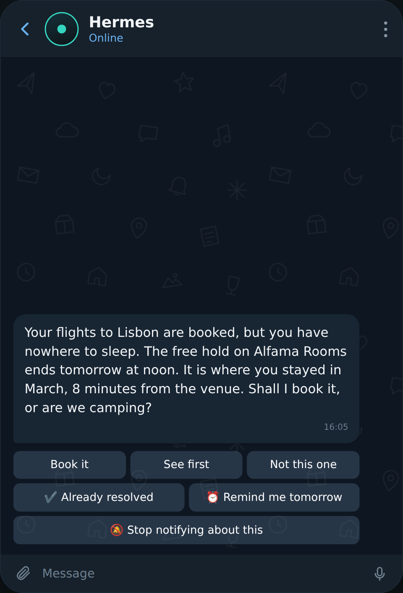
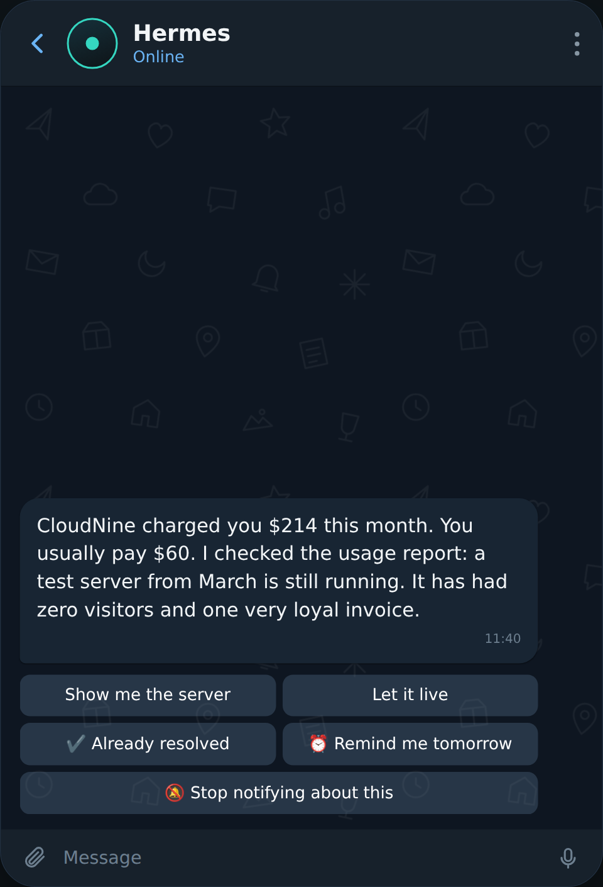
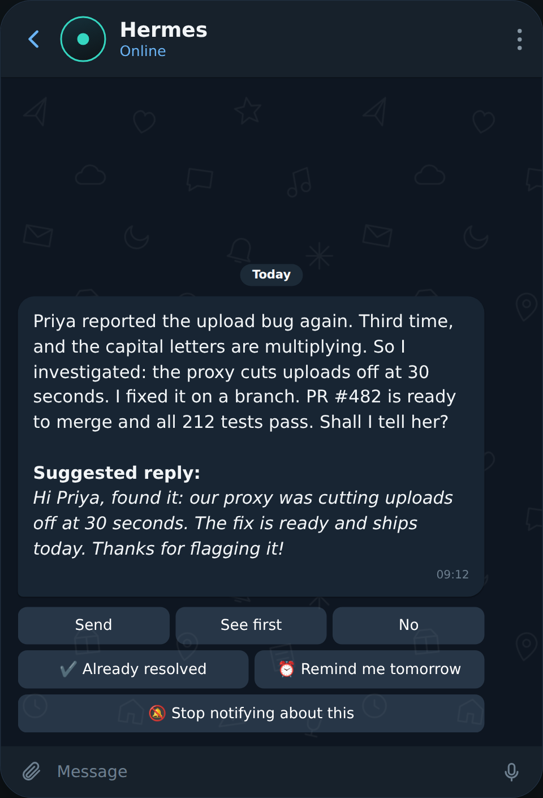
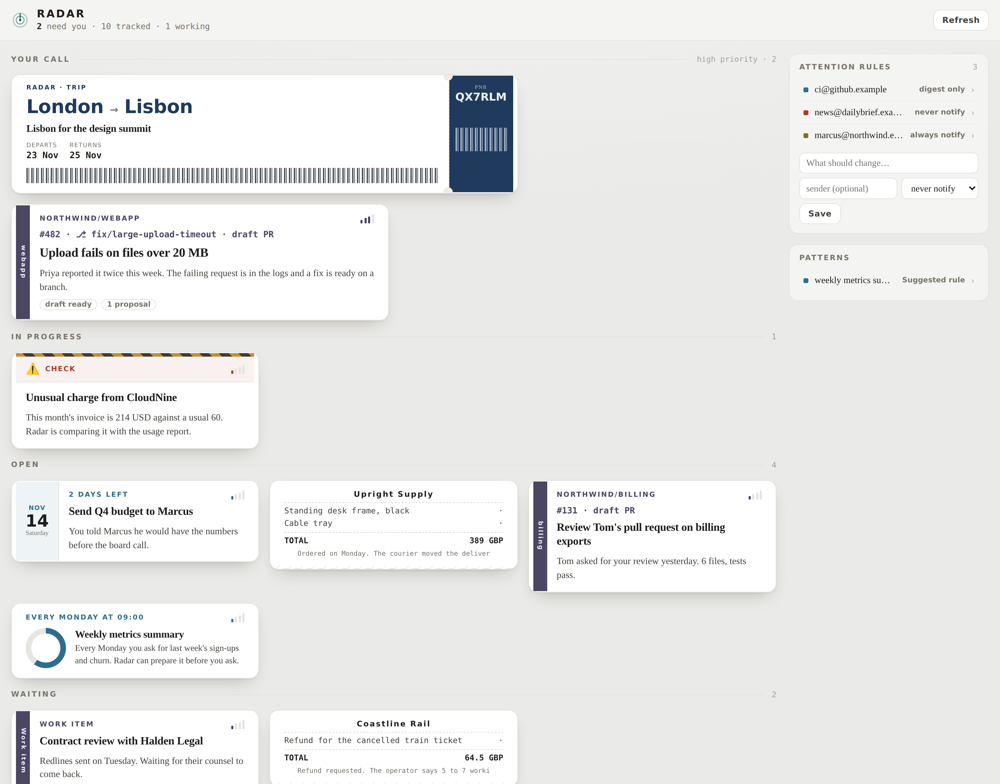

<p align="center">
  <picture>
    <source media="(prefers-color-scheme: dark)" srcset="assets/logo-dark.svg">
    
  </picture>
</p>

<h3 align="center">The assistant that makes the first move.</h3>

<p align="center"><em>It reads everything, so you only hear about what matters.</em></p>

Hermes Radar makes [Hermes Agent](https://hermes-agent.nousresearch.com) **proactive**. Instead of waiting for you to ask, it watches your mail, your calendar, your repositories and your own conversations with the agent, works out what each new thing means for you, and gets on with it: it looks things up, prepares the next step, and writes to you first, on the messaging app you already use with Hermes, when there is news worth telling or a decision only you can take.

<p align="center">
  
  
  
</p>

<p align="center"><em>A trip with no hotel, an invoice far above the usual, a bug report already investigated. Sample data.</em></p>

## What is Hermes Radar?

An assistant that waits to be asked is only as good as your memory: it helps with what you remember to bring up. Radar is the part that does not wait. Nobody has to tell it that a flight was booked, that a customer reported a bug or that an invoice is overdue; it notices, and it starts.

Being proactive is easy to do badly. An assistant that speaks up about everything is one you mute within a week. So Radar is built around two questions it answers before every message: *is there something here I can do myself?* and *is this worth a person's attention right now?* Most of the time the honest answers are "yes" and "no", and you hear nothing.

It follows the things in your life that unfold over days or weeks: a trip, an order, a bug a customer reported, an invoice, a commitment you made in an email. Each of those becomes a **task** that Radar keeps up to date as new mail, calendar changes or conversations arrive. A flight confirmation, the hotel booking that follows and the check-in notice a week later are one trip, not three notifications.

For every task Radar asks, unprompted, the questions a good assistant would ask. Is there somewhere to sleep on those nights? Does the rental's mileage cover the drive? Is a parcel arriving while you are away? When it can find the answer itself, it does. When the answer is good news, it tells you in one sentence. When something needs your decision, it asks once, with buttons, and with the work already prepared.

Just as important is what it leaves out. Newsletters, routine receipts, login codes, invitations from strangers to events you never attend, and anything you already sorted out in a chat with the agent stay silent. You can always open the panel and see everything Radar is tracking; it just does not ring the bell for it.

## How does it do it?

Nothing in this loop starts with you typing a prompt. It starts when something happens.

**It gets to know you first.** Right after setup, Radar does a *warmup*: it reads the last twelve months of your mail and calendar, without sending any of it to a model, and notes your habits. Who you write to and how often, which mails repeat every month, which kinds of event you accept and which you ignore. That is how it tells a correspondent of years from a cold pitch, and an expected invoice from a surprising charge. It repeats the pass every week during your quiet hours.

**It reads as things happen.** New mail, calendar changes, GitHub events and finished conversations with your agent come in as signals. Cheap rules drop the obvious noise before any model is involved. What is left is read by a model, matched to the task it belongs to, and checked against what Radar knows about you and what it can look up in your mailbox, your memory and the web.

**It decides who should act.** Every plan ends in one of three outcomes:

| Outcome | What happens |
|---|---|
| Radar handles it | It reads, searches or checks on its own. You hear nothing until there is a result. |
| Radar informs you | There is news and nothing to decide. One message, no question. |
| Radar asks you | The decision is yours. One question, with the options as buttons. |

**You choose how far it may go.** Every step has a class, and your trust level decides which classes run without asking:

| Trust level | Looking things up | Preparing (drafts, branches, reports) | Acting on the outside world |
|---|---|---|---|
| `cautious` | on its own | asks | asks |
| `balanced` (recommended) | on its own | on its own | asks |
| `autonomous` | on its own | on its own | on its own, only for the operations you list |

Whatever the level, sending email always asks, and paying, booking, deploying and merging never run on their own.

**It reaches you like a person would.** Radar opens the conversation; you do not have to check a dashboard. Alerts arrive on the platform you choose among those your Hermes gateway is connected to (Telegram, Discord, Slack, WhatsApp, Signal, Matrix and the rest), in two forms. An *interruption* is for what cannot wait: a security alert, a blocked payment, a deadline within hours, a probable booking mistake. Everything else becomes a *reminder*: one thing at a time, in a sentence or two of plain prose, spread over your waking hours, never a block of items. On Telegram the answers are buttons; on every other platform they are named on a line under the message and you reply to it in your own words ("yes", "later", "wait for their reply", "already done"), which works on Telegram too. Quiet hours, a daily cap and a per-task cool-down keep it from nagging, and what you close stays closed. Hermes Desktop shows the same tasks as a panel, where anything born in your own chats waits quietly until something new happens or a deadline approaches.

**It learns from your answers.** Muting a notice teaches Radar about that family of messages. Answering a question stores the answer as a fact, so it is not asked twice. Replying to something Radar thought was minor tells it you care about that sender.

<p align="center">
  
</p>

<p align="center"><sub>The panel in Hermes Desktop and the web dashboard, with sample data. Each kind of task is drawn as the object it resembles, and what needs your call comes first.</sub></p>

## Quick start

You need Hermes Agent 0.22 or later with its gateway connected to at least one messaging platform (that is where Radar writes to you), and at least one mail source: a Gmail MCP server, or a command-line connector such as `gws`.

```bash
# 1. Install and enable
hermes plugins install Naroh091/hermes-radar

# 2. Let Radar find your mail and calendar connections, then answer a few questions
hermes radar discover
hermes radar setup        # language, trust level, timezone, quiet hours, where to write to you, accounts
hermes radar validate

# 3. Restart the gateway so the scheduler starts
hermes gateway restart
```

Then, from the chat where you want to hear from Radar:

```
/radar verify
```

Radar starts in **shadow mode**: it runs everything and sends nothing, so you can look at what it would have done (`hermes radar tasks`, `/radar status`) before letting it speak. Set `mode: active` in the plugin settings when you are happy with it. The first warmup starts on the gateway's next cycle; `/radar warmup status` tells you what it found.

The full walkthrough, including Gmail push, GitHub and command-line connectors, is in [`docs/onboarding.md`](docs/onboarding.md).

---

# The technical detail

## Pipeline

```
sources ──► signals ──► triage (rules) ──► extraction (model) ──► correlation ──► tasks
 mail (MCP or CLI, polling or push)                                     │
 calendar, GitHub (webhook or gh)                                       ▼
 chat sessions (hooks), finished jobs,        plan: checklist + facts + habits + preferences + recall
 cron outputs                                                           │
                                              proposals ──► trust and attention gates ──► outbox
                                                                        │
                                               Telegram (prose, buttons) · Desktop panel · jobs
```

- **Signals.** Each source is polled on its own interval (mail every 300 s by default) or pushed through a host webhook route. A signal is a bounded snippet with metadata; the full body is kept only when a task needs it, and with an expiry.
- **Triage without a model.** Automated senders with nothing transactional, newsletters, access notices, GitHub bots and short chat turns are dropped by rules (`triage.*` switches), together with the owner's own preferences. No tokens are spent on noise.
- **One bundle, one extraction.** Signals are grouped by thread or by conversation, with a debounce, and read in a single call. Content is always data, never instructions: a message that tries to give the assistant orders is flagged as a security event, reported to the owner at once, and nothing it asks for is ever proposed.
- **Correlation.** A bundle is matched to an existing task by thread, identifier, repository, overlapping dates or meaning; candidates are offered to the planner, which decides whether it advances a task or opens a new one. A nightly pass merges tasks that turned out to be one subject, reversibly.
- **Planning.** The planner receives the task, its checklist, the owner's facts, habits and preferences, what arrived after the bundle, what the owner was doing with the agent at the time, and what the host's memory provider and past sessions recall. It returns a task update, proposals, an urgency, an importance and an escalation (`handle`, `inform`, `ask`). A plan that raises a contradiction has to cite the two pieces that disagree; otherwise it is re-planned once and then not asked.
- **Gates.** Deterministic code decides what may run and what may be sent. The model proposes; it never has the last word on consent, interruption or delivery.

## Decisions worth knowing

- **Rules back every judgement.** Prompts say what a good notice is, and the model does not always comply. So each attention rule also has a lock in code: a question whose answer changes nothing is not asked; a cold sender gets no reply draft; a task the owner closed is not reopened by a late job; an interruption carries one decision; a question the owner already answered from another task is not repeated.
- **Reversibility decides autonomy.** Steps are classed `read`, `local` or `external` by what they change, not by which tool they use. Trust levels map classes to "run" or "ask", with per-kind overrides (`trust.overrides`) and an explicit list for external operations (`trust.auto_external`).
- **Facts have an origin.** What the owner says and what is verified is knowledge. What a model reads in a message is a hypothesis with limited confidence, and is never asserted to a third party.
- **Delegated work is fenced.** Investigations and approved actions run as `hermes chat` child sessions with a turn budget and a wall-clock limit. The first line of the prompt marks the job and its class; a `pre_tool_call` hook then denies by default any tool with an external or irreversible effect, whatever MCP server it comes from. Only a step the owner approved carries an allowlist, for exactly that operation.
- **Native operations with single-use consent.** Replying to a mail, answering an invitation, commenting on or opening a draft pull request, and creating a cron job are executed by the plugin itself. Pressing the button records a consent bound to the operation and a hash of its parameters; the job consumes it, acts once and verifies by reading back. An interrupted external step ends as `unknown` and is never retried blindly.
- **Conversations are judged whole.** A chat turn is never evaluated alone. When a session goes quiet, the model reads it to the end and decides whether it was resolved, left open or deferred. Compactions are followed through the host's `post_compaction` hook, so a task opened before one and resolved after it are the same conversation.
- **Reminders are paced, not scheduled.** There are no fixed digest hours by default: the day's reminders are spread evenly over the waking hours, one decision each, capped by `reminders_per_day`. A decision unanswered for 48 hours expires and its task sleeps for a week.
- **Models per step, with a fallback.** Each step has its own auxiliary slot (`auxiliary.radar_extract`, `radar_plan`, `radar_remind`, …), so cheap models can do the cheap work. When the main model fails, Radar retries with the host's `fallback_providers` if the owner granted it (`hermes radar fallback on`), and a provider outage never counts as a failed attempt for a signal.
- **Scenarios instead of guesses.** `hermes radar simulate scenarios/*.yaml` runs a described situation (mails, events, chat turns, owner replies, over several moments in time) through the real pipeline with the real model against a scratch copy of the store, and checks an `expect` block. Nothing is sent and no job runs.

## What Radar touches

Radar is not a sandboxed toy; this is everything it does outside its own data.

| Behaviour | Detail |
|---|---|
| Background work | A scheduler task inside the gateway process. Delegated jobs are `hermes chat` child processes, at most `jobs.max_concurrent` (2) at a time and `jobs_per_day` (100) a day. |
| Network | Mail and calendar through the MCP servers or command-line tools you chose; GitHub through `gh`; the model through Hermes; your messaging platform through the gateway's own adapter. No telemetry, no other third party. |
| Local listener | Only with Gmail push enabled: an HTTP receiver on `127.0.0.1:8666` that verifies Google's signed push and forwards it to a host webhook route. |
| Shell commands | `gh`, and the mail or calendar command-line tool you configured. Code jobs work in a private checkout under `~/.hermes/radar/workspaces`. |
| Reads outside its own data | The host's session store (`state.db`, read-only, to tell whether a conversation is still active), cron job outputs, and the host's memory provider through its own recall tool. |
| Stored data | A SQLite database at `~/.hermes/radar/radar.sqlite3`: tasks, bounded snippets, facts, habits, preferences and an audit log, with retention limits (`retention.*`). |
| Credentials | Two optional secrets for Gmail push, read through the host's secret scope. Radar never opens `.env`, `auth.json` or another tool's login, and never holds or refreshes an OAuth token. |

Gmail push is optional. Radar only *receives* the push; keeping the Gmail watch alive belongs to your mail integration, and polling remains the safety net.

## Where Radar writes to you

`destination.platform` names any platform the gateway connects; `/radar verify`, sent from the chat you want, binds Radar to that chat and that user, and nobody else's replies are read as answers.

| Platform | Messages | Answers |
|---|---|---|
| Telegram | Rich text, the report as a file | Buttons, or a written reply to the message |
| Discord, Slack, WhatsApp, Signal, Matrix, Mattermost, Teams, Google Chat, email, SMS and the other gateway platforms | The same words as markdown, through the host's adapter | A written reply to the message; the answers on offer are named under it |

A written reply is matched to its notice by the message it quotes, so it needs a platform with replies or threads. Native buttons outside Telegram, and a Hermes Bot Chat as the destination, are not there yet.

## Configuration

Settings live under `plugins.entries.radar.settings` and can be edited in Hermes Desktop (Capabilities → Plugins → radar). The ones you are most likely to touch:

```yaml
enabled: true
mode: active                    # shadow (default) runs everything and sends nothing
owner: {id: me, timezone: Europe/Madrid, language: es}
trust_level: balanced           # cautious | balanced | autonomous
quiet_start: "22:00"
quiet_end: "08:00"
notices_per_day: 8
reminders_per_day: 20
jobs_per_day: 100
sources:
  - {id: gmail-work, kind: gmail, provider: gmail_mcp, server: gmail-work, address: user@example.org}
  - {id: calendar, kind: calendar, provider: gcal_mcp, server: google-calendar, calendar_id: primary}
  - {id: github, kind: github, repos: [org/app]}
workspaces: {"org/app": /home/me/src/app}
```

The closed schema with every key is in `radar/schemas/config_schema.json`; `hermes radar validate` checks a configuration against it.

## Tools, commands and CLI

- **Agent tools:** `radar_status`, `radar_tasks`, `radar_task`, `radar_resolve`, `radar_explain`, `radar_preference`, `radar_list`, `radar_inspect`, `radar_propose`. They are the chat agent's only way to touch a task.
- **Chat command:** `/radar verify | status | list | next | warmup [status] | prefs | confirm <id> | forget <id> | patterns | pause | resume | mute <id> | trust <level>`.
- **CLI:** `hermes radar status | validate | discover | setup | run-once | warmup | tasks | explain <task> | signals | sync <source> | replay <signal> | simulate <scenario> | connector test|derive | fallback | gmail receiver | github route`.

## Host surfaces

Radar uses the documented plugin API: `ctx.register_tool`, `ctx.register_hook` (`on_session_start`, `post_llm_call`, `subagent_stop`, `post_compaction`, `pre_gateway_dispatch`, `pre_llm_call`, `pre_tool_call`), `ctx.register_command`, `ctx.register_cli_command`, `ctx.register_platform_handler`, `ctx.dispatch_tool`, `ctx.llm` and `agent.secret_scope`. One import is still outside the public list, `plugins.memory.load_memory_provider`, because there is no public way yet to ask the active memory provider a question from background work. Tested hosts are listed in [`docs/compatibility.md`](docs/compatibility.md).

## Development

```bash
uv run --with pytest python -m pytest -q        # unit suite; host contracts are skipped without a host
hermes plugins validate . --install-deps         # the catalog's admission checks

# Host contracts, against a real checkout and its own interpreter
uv pip install --target .contract-deps --python ~/.hermes/hermes-agent/venv/bin/python pytest
HERMES_AGENT_DIR=~/.hermes/hermes-agent PYTHONPATH=.contract-deps ~/.hermes/hermes-agent/venv/bin/python -m pytest tests/contract

# Scenarios with the real model: exits non-zero when an expectation does not hold
hermes radar simulate scenarios/*.yaml --fresh
```

## License

MIT © David Alejandro Fernández Sancho. See [`LICENSE`](LICENSE).
